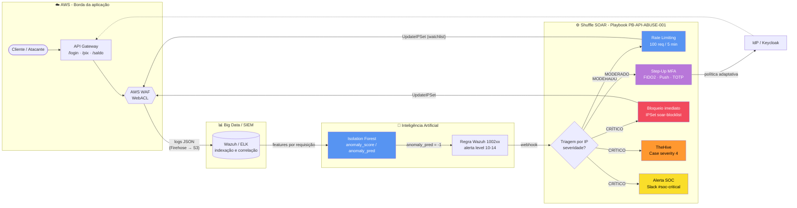
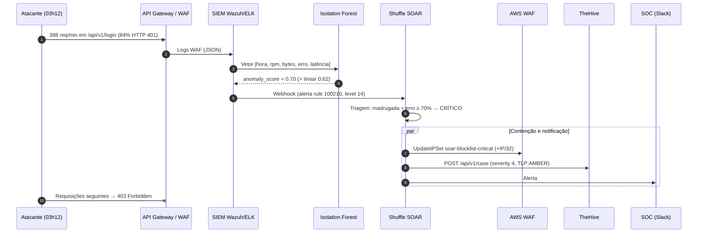
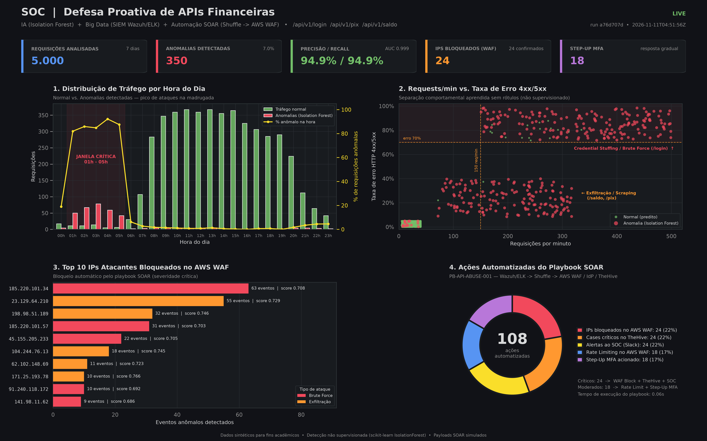

# 🛡️ Defesa Proativa com IA, Big Data e Automação SOAR

> Protótipo acadêmico de **detecção comportamental de ataques a APIs financeiras** com *Machine Learning* não supervisionado (**Isolation Forest**) e **resposta automatizada a incidentes** via orquestração SOAR (Wazuh/ELK → Shuffle → AWS WAF / TheHive).


---

## 📌 Sumário

1. [Cenário](#-cenário)
2. [Arquitetura da solução](#-arquitetura-da-solução)
3. [Fluxo de resposta automatizada (Mermaid)](#-fluxo-de-resposta-automatizada)
4. [Como o Isolation Forest detecta ataques em APIs](#-como-o-isolation-forest-detecta-ataques-em-apis)
5. [Playbook SOAR](#-playbook-soar)
6. [Estrutura do repositório](#-estrutura-do-repositório)
7. [Como executar](#-como-executar)
8. [Resultados obtidos](#-resultados-obtidos)
9. [Limitações e trabalhos futuros](#-limitações-e-trabalhos-futuros)

---

## 🏦 Cenário

Uma **instituição financeira em migração para a nuvem (AWS)** expõe APIs críticas por meio de um API Gateway protegido por AWS WAF:

| Endpoint | Função | Ameaça principal |
|---|---|---|
| `/api/v1/login` | Autenticação do cliente | **Credential Stuffing / Brute Force** (MITRE T1110.004 / T1110.001) |
| `/api/v1/pix` | Transferências instantâneas | **Exfiltração / Scraping** de dados e chaves (T1119 / T1020) |
| `/api/v1/saldo` | Consulta de saldo/extrato | **Exfiltração / Scraping** (BOLA, enumeração de contas) |

Os ataques se concentram **fora do horário comercial (madrugada, 01h–05h)**, quando a equipe do SOC está reduzida e o tempo de resposta manual é maior. Regras estáticas de WAF (assinaturas, limites fixos) não acompanham atacantes que rotacionam IPs e variam a cadência. A proposta é **aprender o comportamento normal** do tráfego e **responder automaticamente** a desvios, em segundos.

---

## 🏗️ Arquitetura da solução

A solução se organiza em quatro camadas, cada uma mapeada para um script da pipeline:

| Camada | Componente real (produção) | Simulação neste repositório |
|---|---|---|
| **Coleta / Big Data** | AWS API Gateway + AWS WAF logs → Kinesis Firehose → S3 → **Wazuh / ELK** | `src/1_generate_logs.py` → `data/api_logs.csv` |
| **Inteligência Artificial** | Job de ML (SageMaker / Elastic ML / container) consumindo o índice do SIEM | `src/2_anomaly_detection.py` → `data/analyzed_logs.csv` |
| **Orquestração (SOAR)** | **Shuffle SOAR** acionado por webhook do Wazuh | `src/3_soar_playbook.py` → `output/soar_actions_payload.json` |
| **Resposta / Visualização** | AWS WAF (IPSet), IdP (Step-Up MFA), **TheHive**, Slack; Grafana/Kibana | Payloads simulados + `src/4_generate_dashboard.py` |

### Features comportamentais utilizadas

| Feature | Significado | Por que diferencia ataques |
|---|---|---|
| `hour_of_day` | Hora da requisição (0–23) | Ataques concentrados na madrugada |
| `requests_per_min` | Cadência do cliente | Bots/credential stuffing: 150–500 req/min vs. 5–40 de humanos |
| `bytes_transferred` | Volume da resposta | Exfiltração/scraping: centenas de KB a MB por janela |
| `error_rate_4xx_5xx` | Proporção de erros HTTP | Brute force gera > 70% de `401/403/429` |
| `latency_ms` | Latência no backend | Ataques estressam IdP e core banking |

> [!NOTE]
> A coluna `is_attack_ground_truth` **nunca é usada no treinamento**. Ela existe apenas para validar, a posteriori, a qualidade da detecção não supervisionada.

---

## 🔄 Fluxo de resposta automatizada



### Sequência temporal de um incidente crítico



---

## 🌲 Como o Isolation Forest detecta ataques em APIs

O **Isolation Forest** (Liu, Ting & Zhou, 2008) parte de uma premissa simples: **anomalias são poucas e diferentes**, portanto são **mais fáceis de isolar** do que pontos normais.

1. **Construção das árvores:** cada *iTree* recebe uma subamostra (256 registros por padrão) e particiona o espaço recursivamente, escolhendo **uma feature aleatória** e **um ponto de corte aleatório** entre o mínimo e o máximo dessa feature.
2. **Comprimento do caminho:** um ponto normal (ex.: 18 req/min às 14h, 2% de erro) está numa região densa e precisa de **muitos cortes** para ficar sozinho. Um credential stuffing (400 req/min às 03h, 85% de erro) fica isolado em **pouquíssimos cortes**.
3. **Score de anomalia:** a média do comprimento de caminho `E(h(x))` em todas as árvores é normalizada por `c(n)` (caminho médio de uma busca malsucedida em uma BST):

$$
s(x, n) = 2^{-\frac{E(h(x))}{c(n)}}, \qquad c(n) = 2H(n-1) - \frac{2(n-1)}{n}
$$

- `s → 1`: ponto isolado rapidamente → **anomalia**;
- `s ≪ 0.5`: ponto em região densa → **normal**.

No código, `anomaly_score = -model.score_samples(X)`, que corresponde exatamente a `s(x, n)` do artigo original. O parâmetro `contamination=0.07` define o limiar de decisão (`anomaly_pred = -1`) como o percentil 93% dos scores, refletindo a taxa de base esperada pelo SOC.

**Por que é adequado para APIs financeiras?**

- ✅ **Não supervisionado** — não depende de rótulos (raros e caros em segurança) e detecta *zero-days* comportamentais.
- ✅ **Complexidade linear** `O(t · ψ · log ψ)` — escala para o volume de logs de um API Gateway (Big Data).
- ✅ **Multivariado** — captura combinações (ex.: volume alto **e** madrugada **e** erro alto) que regras estáticas isoladas não capturam.
- ✅ **Score contínuo** — permite **resposta graduada** no SOAR (moderado vs. crítico), reduzindo o impacto de falsos positivos.

---

## ⚙️ Playbook SOAR

O script `src/3_soar_playbook.py` simula o playbook **`PB-API-ABUSE-001`** no Shuffle SOAR. As anomalias são agrupadas por `source_ip` e classificadas:

| Severidade | Condição | Ações automatizadas |
|---|---|---|
| 🟠 **MODERADA** | `anomaly_pred = -1` sem indicadores críticos | **Rate Limiting** no AWS WAF (IPSet `soar-ratelimit-watchlist` + regra rate-based 100 req/5 min) **+ Step-Up MFA** obrigatório no IdP (FIDO2 / Push / TOTP, TTL 1h) |
| 🔴 **CRÍTICA** | Atividade na madrugada **e** (erro ≥ 70% **ou** ≥ 150 req/min **ou** ≥ 100 kB/req) **ou** `anomaly_score ≥ 0.68` | **Bloqueio imediato** no AWS WAF (IPSet `soar-blocklist-critical`) **+ Case crítico no TheHive** (severity 4, TLP:AMBER, tarefas de contenção/erradicação/LGPD) **+ Alerta no SOC** (Slack `#soc-critical`) |

Também há uma **allowlist** (`10.0.0.0/8`, `172.16.0.0/12`, `192.168.0.0/16`) para suprimir falsos positivos de health checks e scanners autorizados.

### Payloads de integração gerados (`output/soar_actions_payload.json`)

Cada incidente contém os payloads no formato real das respectivas APIs:

| Integração | Formato |
|---|---|
| SIEM → SOAR | Alerta **Wazuh** (`rule.id`, `rule.level`, `rule.mitre`, `data.srcip`, `data.ml.*`) |
| Gatilho SOAR | **Shuffle** webhook (`POST /api/v1/hooks/webhook_<id>`, `execution_argument`) |
| Contenção | **AWS WAFv2** `UpdateIPSet` (`X-Amz-Target: AWSWAF_20190729.UpdateIPSet`) + regra `RateBasedStatement` |
| Autenticação | IdP adaptativo — política `REQUIRE_STEP_UP_MFA` |
| Gestão de casos | **TheHive 5** `POST /api/v1/case` + observable `ip` como IOC |
| Notificação | **Slack** Incoming Webhook (Block Kit) |

Trecho resumido de um incidente crítico:

```json
{
  "incident_id": "INC-20261111-0003",
  "source_ip": "198.98.51.189",
  "severity": "CRITICAL",
  "attack_label": "Data Exfiltration / API Scraping",
  "mitre_attack": ["T1119", "T1020"],
  "actions": [
    { "action": "aws_waf.ip_set.add_address", "ip_set": "soar-blocklist-critical", "address": "198.98.51.189/32" },
    { "action": "thehive.case.create", "request": { "method": "POST", "url": "https://thehive.soc.bank.local/api/v1/case",
      "body": { "severity": 4, "tlp": 2, "flag": true, "tags": ["soar:auto", "mitre:T1119"] } } },
    { "action": "soc.notify.slack" }
  ]
}
```

> [!IMPORTANT]
> Nenhuma chamada de rede é realizada. Os endpoints, tokens e IDs são fictícios; as respostas das APIs são simuladas. Para uso real, substitua os construtores de payload por chamadas autenticadas (boto3 `wafv2.update_ip_set`, `thehive4py`, `requests` para webhooks).

---

## 📁 Estrutura do repositório

```text
.
├── README.md
├── requirements.txt
├── run_pipeline.py                  # executa as etapas 1 → 4 e valida os artefatos
├── src/
│   ├── 1_generate_logs.py           # dataset sintético de API Gateway / WAF
│   ├── 2_anomaly_detection.py       # Isolation Forest + métricas de validação
│   ├── 3_soar_playbook.py           # motor SOAR simulado (Wazuh → Shuffle → WAF/TheHive)
│   └── 4_generate_dashboard.py      # painel dark theme (Grafana/Kibana style)
├── data/
│   ├── api_logs.csv                 # 5.000 requisições (93% normais / 7% ataques)
│   └── analyzed_logs.csv            # + anomaly_pred, anomaly_score
└── output/
    ├── model_metrics.json           # matriz de confusão, precisão, recall, ROC-AUC
    ├── soar_actions_payload.json    # payloads de integração SIEM/SOAR/WAF/TheHive
    ├── soar_execution.log           # log formatado da execução do playbook
    └── security_dashboard.png       # dashboard 300 DPI
```

---

## 🚀 Como executar

**Pré-requisito:** Python 3.10+.

```bash
# 1. Clonar e entrar no repositório
git clone <url-do-repositorio>
cd <repositorio>

# 2. Criar e ativar ambiente virtual
python -m venv .venv
# Windows (PowerShell)
.venv\Scripts\Activate.ps1
# Linux / macOS
source .venv/bin/activate

# 3. Instalar dependências
pip install -r requirements.txt
```

**Execução completa (recomendada):**

```bash
python run_pipeline.py
```

**Ou etapa por etapa:**

```bash
python src/1_generate_logs.py        # gera data/api_logs.csv
python src/2_anomaly_detection.py    # treina o Isolation Forest e exibe as métricas
python src/3_soar_playbook.py        # executa o playbook SOAR (log colorido no terminal)
python src/4_generate_dashboard.py   # gera output/security_dashboard.png
```

Parâmetros opcionais:

```bash
python src/1_generate_logs.py --rows 20000 --attack-ratio 0.05 --seed 7
python src/2_anomaly_detection.py --contamination 0.05 --n-estimators 500
```

> [!TIP]
> Para capturar o log do SOAR para relatório, execute `python src/3_soar_playbook.py` em um terminal com suporte a cores ANSI (Windows Terminal, VS Code, bash) ou abra `output/soar_execution.log`.

---

## 📈 Resultados obtidos

Execução de referência (`seed=42`, 5.000 requisições, `contamination=0.07`):

### Detecção (Isolation Forest)

| Métrica | Valor |
|---|---|
| Anomalias detectadas | **350** (7,0% do tráfego) |
| Precisão | **94,86%** |
| Recall | **94,86%** |
| F1-Score | **0,9486** |
| Acurácia | 99,28% |
| Taxa de falso positivo | **0,39%** |
| ROC-AUC (`anomaly_score`) | **0,9989** |

|  | Pred. Normal | Pred. Anomalia |
|---|---|---|
| **Real Normal** | 4.632 (TN) | 18 (FP) |
| **Real Ataque** | 18 (FN) | 332 (TP) |

**Análise dos erros:**

- **18 falsos positivos:** requisições legítimas em horário comercial com **picos de latência de backend (~2 a 2,5 s)**, simulando *cold start* de Lambda ou lock no core banking. São outliers reais, porém não maliciosos: um bom exemplo de por que a resposta precisa ser graduada.
- **18 falsos negativos:** eventos de credential stuffing **na madrugada** (02h–04h) com score entre 0,610 e 0,624, logo abaixo do limiar (0,6244). Como o ataque gera **muitos pontos parecidos entre si**, o cluster fica denso e cada ponto exige mais cortes para ser isolado. Esse é o efeito de **mascaramento** (*masking*) descrito no artigo original. Como o orçamento de `contamination` foi consumido pelos picos de latência, esses pontos ficaram de fora. Mesmo assim, **os IPs de origem foram bloqueados**, porque a triagem do SOAR agrega os eventos **por IP**.

### Resposta automatizada (SOAR)

| Indicador | Valor |
|---|---|
| IPs suspeitos (agrupados) | 42 |
| Incidentes **críticos** → IPs bloqueados no AWS WAF | **24** |
| Cases críticos no TheHive / alertas ao SOC | 24 / 24 |
| Incidentes **moderados** → Rate Limiting + Step-Up MFA | 18 |
| Total de ações automatizadas | **108** |
| IPs bloqueados que eram atacantes reais | **24 / 24 (100%)** — nenhum cliente legítimo bloqueado |
| Tempo de execução do playbook | < 0,1 s |

> [!NOTE]
> A **resposta graduada** é o ponto-chave: todos os falsos positivos do modelo caíram na faixa **moderada** e receberam apenas *rate limiting* + Step-Up MFA (fricção mínima ao cliente legítimo, que consegue se autenticar), enquanto **100% dos IPs atacantes** foram bloqueados no WAF.

### Dashboard



---

## 🔭 Limitações e trabalhos futuros

- **Dados sintéticos:** os padrões de ataque são bem definidos; em produção, haverá sobreposição maior (ataques *low-and-slow*, proxies residenciais). Validar com datasets públicos (ex.: CSIC 2010, CIC-IDS2017) ou logs reais anonimizados.
- **`hour_of_day` linear:** 23h e 00h ficam "distantes"; uma codificação cíclica (`sin`/`cos`) é mais fiel.
- **Features por sessão/janela:** agregações por IP, ASN, *device fingerprint* e conta-alvo (Big Data em streaming com Kafka/Flink) aumentam a robustez.
- **Feedback loop:** decisões dos analistas no TheHive podem retroalimentar um modelo supervisionado (*active learning*).
- **Integração real:** substituir os payloads simulados por chamadas via `boto3`, `thehive4py` e workflows exportados do Shuffle.
- **Conformidade:** alinhamento com a Resolução CMN nº 4.893/2021 (política de segurança cibernética para instituições financeiras) e LGPD (comunicação de incidentes à ANPD).

---

## 📚 Referências

- LIU, F. T.; TING, K. M.; ZHOU, Z.-H. *Isolation Forest*. IEEE ICDM, 2008.
- MITRE ATT&CK® — T1110 (Brute Force), T1119 (Automated Collection), T1020 (Automated Exfiltration).
- OWASP API Security Top 10 (2023) — API2: Broken Authentication; API4: Unrestricted Resource Consumption.
- Documentação: [scikit-learn IsolationForest](https://scikit-learn.org/stable/modules/generated/sklearn.ensemble.IsolationForest.html) · [AWS WAFv2 UpdateIPSet](https://docs.aws.amazon.com/waf/latest/APIReference/API_UpdateIPSet.html) · [Wazuh](https://documentation.wazuh.com/) · [Shuffle](https://shuffler.io/docs) · [TheHive 5](https://docs.strangebee.com/).

---

<sub>Projeto acadêmico — dados e integrações simulados para fins educacionais.</sub>
